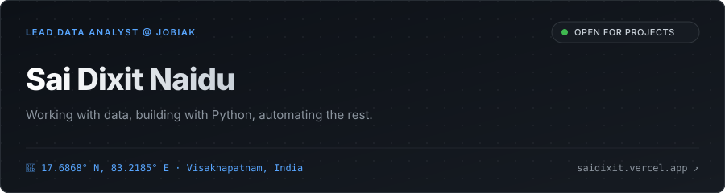

<picture>
  <source media="(prefers-color-scheme: dark)" srcset="assets/header-dark.svg">
  <source media="(prefers-color-scheme: light)" srcset="assets/header-light.svg">
  
</picture>

<div align="center">

[saidixit.vercel.app](https://saidixit.vercel.app/) &nbsp;·&nbsp; [Works](https://saidixit.vercel.app/works/) &nbsp;·&nbsp; [Experience](https://saidixit.vercel.app/experience) &nbsp;·&nbsp; [Writing](https://saidixit.vercel.app/blog/) &nbsp;·&nbsp; [LinkedIn](https://www.linkedin.com/in/sai-dixit) &nbsp;·&nbsp; [Twitter / X](https://x.com/SaiDixitNaidu) &nbsp;·&nbsp; [saidixitn@gmail.com](mailto:saidixitn@gmail.com)

</div>

---

### Overview

I find where information gets stuck, then build what gets it moving.

I work on high-volume data querying, search engine indexing architecture, and deterministic automation. Most of my time is spent inside job market datasets, Google for Jobs schema structures, BigQuery, and writing Python pipelines that eliminate manual verification.

```
01 / Spot the pattern  — Locate where data gets stuck or why a check is done twice.
02 / Build the fix      — Write the script, repair the schema, or design the tool.
03 / Automate it        — If it runs on a schedule, code should do it in the background.
04 / Keep it calm       — No bloat. Software that stays out of your way and does its job.
```

---

### Selected Systems & Repositories

#### [glance](https://github.com/saidixitn/glance)
`macOS Biometrics` · `Swift` · `Core ML` · `Vision Framework` · `On-Device Security`

Face unlock for macOS living directly inside the MacBook notch and Dynamic Island. Built using Apple Vision and Core ML frameworks to perform liveness detection and facial recognition on-device. Face vectors and credentials never touch a network socket.

- Operates in memory without persisting video frames to disk
- Integrated with local macOS Keychain for credential gating
- Responsive animations engineered specifically for notch geometries

---

#### [Job-Posting-Alerts](https://github.com/saidixitn/Job-Posting-Alerts)
`Differential Monitoring` · `Python` · `Google for Jobs` · `Search Console API`

Autonomous telemetry engine tracking millions of structured job listings. Built on the principle that alerts should fire on *change*, not on *state*—comparing historical run diffs to detect schema errors and indexing drops before listings disappear from search results.

- Differential state analysis across successive feed ingestions
- Automated Schema.org structure validation and anomaly interception
- Headless webhook dispatch for immediate operational intervention

---

#### [antigravity-nodejs](https://github.com/saidixitn/antigravity-nodejs)
`Data Systems` · `Node.js` · `MongoDB Aggregations` · `REST Engine`

High-throughput MongoDB pipeline engine and REST orchestrator. Designed for clean multi-tenant isolation, high-volume ingestion, and complex analytical aggregations without heavy ORM overhead.

- Tailored MongoDB aggregation pipelines for performant querying
- Resilient asynchronous task handling and clean error boundaries
- Lightweight, zero-bloat REST API architecture

---

#### [daybook](https://github.com/saidixitn/daybook)
`Operational Ledger` · `JavaScript` · `Telemetry` · `Zero-Backend`

A focused, local-first execution tracker and developer ledger. Built to record task lifecycles, script run histories, and operational notes without relying on external server infrastructure.

- Fast, client-side persistence with minimal runtime footprint
- Uncluttered interface designed for quick status checks and logging
- Clean separation between recording and viewing data

---

#### [Automation](https://github.com/saidixitn/Automation)
`Headless Fleet` · `Python` · `Cron Daemons` · `Linux Systems`

A modular suite of production Python daemons, cron workers, and headless scrapers handling recurring ETL workloads, data normalization, and system checks without human intervention.

- Deterministic workers designed to fail safely and report anomalies
- Automated data extraction and partner feed sanitation pipelines
- Minimal dependencies with straightforward CLI invocation

---

#### [wrapper-studio](https://github.com/saidixitn/wrapper-studio)
`Creative Engineering` · `Semantic Web` · `Motion Design` · `HTML5 / CSS3`

Digital product showcase demonstrating modern layout techniques, fluid CSS transitions, and semantic architecture. Proof that fast, interactive web experiences do not require heavy JavaScript frameworks.

---

### Technical Manifest

```yaml
data_infrastructure:
  querying_storage:    [Python, SQL, Google BigQuery, MongoDB, Pandas, NumPy]
  search_intelligence: [Google for Jobs, Google Search Console, Schema.org, Structured Data, Technical SEO]
  pipelines:           [Feed Sanitation, Schema Verification, Indexing Telemetry, Run Diffs]

automation_systems:
  orchestration:       [GitHub Actions, Docker, n8n, Headless Workers, Linux Daemons]
  monitoring:          [Change-Detection Webhooks, Indexing Alerts, Cron Schedulers]
  integrations:        [REST APIs, WebSockets, Local Sockets, Vercel Edge Functions]

artificial_intelligence:
  models_evaluation:   [LLMs, OpenAI API, Ollama, Prompt Architecture, Output Evaluation]
  credentials:         ["AI Foundations" by OpenAI Academy (ID: c92ba288-81e6-4a41-ba20-f11055010ed8)]

platforms_interfaces:
  native_systems:      [Swift, SwiftUI (macOS Vision & Core ML)]
  web_craft:           [Vanilla JavaScript, Node.js, Semantic HTML5, Pure CSS Motion, Zero-Framework UI]
```

---

### Writing & Notes

- [Alerts people trust: what I learned building a monitoring bot](https://saidixit.vercel.app/blog/alerts-people-trust)  
  *Why alerting on change matters more than alerting on state, and how to stop alert fatigue.*

- [Why job postings drop out of Google for Jobs](https://saidixit.vercel.app/blog/why-job-postings-drop-out-of-google-for-jobs)  
  *Common schema failures, crawl timing issues, and indexing mechanics observed across millions of jobs.*

- [Daybook: building without a backend](https://saidixit.vercel.app/blog/daybook-no-backend)  
  *How to build useful developer tools that run entirely in the browser without server maintenance.*

---

### Telemetry

<picture>
  <source media="(prefers-color-scheme: dark)" srcset="https://raw.githubusercontent.com/saidixitn/saidixitn/output/github-contribution-grid-snake-dark.svg">
  <source media="(prefers-color-scheme: light)" srcset="https://raw.githubusercontent.com/saidixitn/saidixitn/output/github-contribution-grid-snake.svg">
  
</picture>

<p align="left">
  
  &nbsp;&nbsp;
  
</p>

---

<div align="center">
  <sub>Sai Dixit Naidu · Visakhapatnam, India · <a href="https://saidixit.vercel.app/">saidixit.vercel.app</a></sub>
</div>
